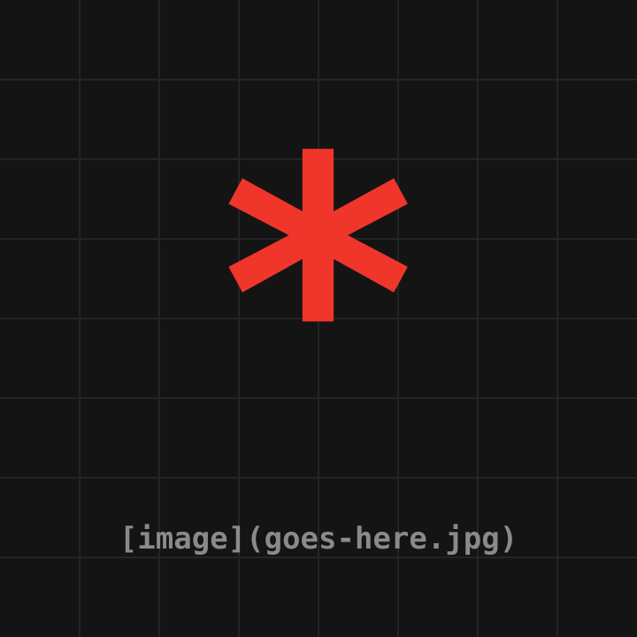

<!-- _class: title -->



# Unrendered.

## A theme for people who trust the source more than the render.

[a name](an at email). &amp;copy; 2026.

---


# Outline

* Intro
* Demo of some **web** stuff
* Demo of some **CLI** stuff
* Getting more from _it_
* Random examples
* Closing remarks **/** quotes
* _Questions_ **/** _discussion_

---

<!-- _class: lead -->

# Demos

## Using a &ldquo;**web browser**&rdquo; and a &ldquo;**terminal**&rdquo;!

---

<!-- _class: cols -->

# Basic CLI Usage

```console
$ curl https://api.example.com/v1/chat \
  -H "Content-Type: application/json" \
  -d '{
    "model": "gpt-3.5-turbo",
    "messages": [
      {
        "role": "user",
        "content": "Hello!"
      }
    ]
  }'
```

```json
{
  "id": "chatcmpl-123",
  "object": "chat.completion",
  "choices": [{
    "message": {
      "role": "assistant",
      "content": "Hello there!"
    }
  }]
}
```

---

# Getting more from it

The trick is piping `jq` at the problem until it goes away.

| tool   | job                | verdict     |
| ------ | ------------------ | ----------- |
| curl   | fetch the thing    | reliable    |
| jq     | mangle the thing   | **magic**   |
| bash   | glue the things    | _eventually_ |

> Nobody ever got fired for adding another pipe.

---

<!-- _class: quotes -->

# Closing remarks **/** quotes

> &ldquo;8 part-time staff in a month produced 300 reports. The script has produced **3 million** in a couple of weeks.&rdquo;

> &ldquo;our lead times with clients were usually weeks, **now they're minutes**&rdquo;

> &ldquo;our KPIs are **all meaningless now**&rdquo;

---


# Questions **/** Discussion?
